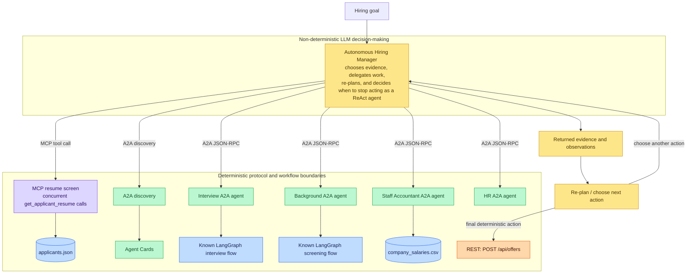

# Multi-Protocol Agent Orchestration with A2A, MCP, and REST

This repo is a playground where I play with agent-to-agent **(A2A)**, **MCP**, and **REST** apis. In this demo, I have a mock hiring manager (**ReAct**-style agent) that works autonomously at an airline company to make a hiring decision using:
 
- **FastAPI** hosts the backend, REST API, A2A routes, and MCP HTTP application.
- **A2A (Agent-to-Agent)** exposes discoverable specialist agents through Agent Cards and JSON-RPC endpoints.
    - Interview Agent - Conducts interviews. 
    - HR Agent - Assists with the hiring process. 
    - Staff Accountant Agent - Provides company salary bands to hiring manager.
- **MCP (Model Context Protocol)** exposes applicant-resume retrieval as a tool.
- **REST** provides a conventional deterministic action for reaching out to the job applicant to extend a mock job offer.
- **LangGraph** runs the known, ordered background-screening and interview pipelines.
- **LLM tool calling / autonomous orchestration** lets the Hiring Manager choose what evidence to collect, which specialist to consult, whether to investigate another applicant, and when to make an offer.

The key architectural point is that A2A does not replace regular backend architecture. A2A is used selectively at service and agent boundaries. HTTP routing, MCP invocation, REST actions, data access, Agent Card handling, and known LangGraph flows remain deterministic. The Hiring Manager is intentionally the non-deterministic decision-making layer between those boundaries.

The Employee Background Agent returns the complete mock background-check and drug-test records. This lets the Hiring Manager reason over the underlying screening details instead of only a final label.

## Architecture



#### Legend

- 🟪 **(Purple)**: MCP
- 🟩 **(Green)**: A2A
- 🟨 **(Yellow)**: Hiring Manager (ReAct Agent)
- 🟧 **(Orange)**: REST 
- 🟦 **(Blue)**: Deterministic internal workflow

The autonomous manager does not follow a hard-coded hiring sequence. It can discover agents, inspect their cards, fetch a resume over MCP, delegate interview or background work through A2A, compare the returned evidence, and change its plan when that evidence changes. When it has sufficient evidence, it calls the conventional REST endpoint that extends the mock offer.

The A2A agents themselves are edge services. In the current implementation, the Interview and Employee Background agents use deterministic LangGraph node order internally, while the HR and Staff Accountant agents use constrained model prompts with supplied data. This keeps protocol adapters, data access, and known workflow steps beneath the agent boundary rather than turning every component into an autonomous agent.

## Backend service

The backend is a single FastAPI service started from `app.main:app`. It mounts the deterministic REST offer route at `/api/offers`, the Streamable HTTP MCP application at `/mcp/mcp`, and the configured A2A JSON-RPC and Agent Card routes under `/a2a`. At startup, `router_a2a.py` reads `agents_config.yaml`, creates an Agent Card and request handler for each configured agent, and connects that handler to the matching pipeline in `agent_pipelines.py`. The backend owns the protocol adapters, local JSON and CSV data access, and the ordered LangGraph workflows. It does not decide which applicant should be hired; it returns the result of the particular endpoint, tool, or agent request it receives.

## Client service: autonomous Hiring Manager

There is no browser-based frontend in this repository. The demo's client, or frontend to the backend services, is the command-line Python program in `manager_client/hiring_manager.py`. It gives the model a hiring goal, the `MANAGER_INSTRUCTIONS` policy, and the `TOOLS` list. Each entry in `TOOLS` is a JSON-schema description that binds a model-visible tool name, such as `list_agents`, `get_all_applicant_resumes`, or `extend_offer`, to the corresponding Python behavior in `execute_tool`. That function then calls the A2A, MCP, or REST client module and returns the observation to the model.

The Hiring Manager uses a ReAct-style loop. It starts with `get_all_applicant_resumes`, which retrieves all five resumes concurrently through MCP, then uses that complete initial screen to choose no more than two active candidates for deeper investigation. It then emits further tool calls as needed, observes their results, and decides again. This is not a hard-coded sequence of hiring steps. The next `responses.create` call passes `previous_response_id=response.id` along with the tool outputs, so the OpenAI response chain retains the earlier conversation and observations for the current run. It also uses the manager instructions to avoid repeating known facts. This is run-scoped conversation memory, not a database or durable memory store: starting the script again starts a new hiring run. The Markdown audit report records the work for a person to review, but it is not fed back into the model as memory.

## Prerequisites

- Python installed and available as `python`.
- Install the pinned project dependencies from `requirements.txt`:

  ```cmd
  python -m pip install -r requirements.txt
  ```

- A root-level `.env` file containing `OPENAI_API_KEY` and `LLM_MODEL` for the model-backed agents and Hiring Manager.

The repository includes a local `run_server.bat` convenience script. It starts the same `app.main:app` FastAPI application shown below.

## Start the backend locally

Open a terminal in the repository root, then use either Windows Command Prompt or PowerShell.

### Windows Command Prompt

```cmd
cd /d C:\Users\Laptop\Desktop\Coding\A2A\multi_protocol_agent_orchestration
uvicorn app.main:app --reload
```

Or run:

```cmd
run_server.bat
```

### PowerShell

```powershell
Set-Location C:\Users\Laptop\Desktop\Coding\A2A\multi_protocol_agent_orchestration
uvicorn app.main:app --reload
```

Keep the backend running while using the endpoint examples or the autonomous client. Stop it with `Ctrl+C`.

## Local URLs

| URL | Purpose |
| --- | --- |
| `http://127.0.0.1:8000` | FastAPI server base URL |
| `http://127.0.0.1:8000/docs` | Interactive FastAPI / OpenAPI documentation |
| `http://127.0.0.1:8000/openapi.json` | OpenAPI document |
| `http://127.0.0.1:8000/a2a/agents` | A2A agent directory |
| `http://127.0.0.1:8000/a2a/{agent_id}/.well-known/agent-card.json` | Agent Card for an agent ID |
| `http://127.0.0.1:8000/a2a/{agent_id}/jsonrpc` | A2A JSON-RPC message endpoint |
| `http://127.0.0.1:8000/api/offers` | REST endpoint for the mock offer action |
| `http://127.0.0.1:8000/mcp/mcp` | Streamable HTTP MCP endpoint used by the manager client |

Available agent IDs are currently `hr`, `employee_background`, `staff_accountant`, and `interview`. Discover them from `/a2a/agents` rather than relying on this list in an A2A client.

## Endpoint examples (Windows CMD)

These examples use `curl.exe` so they work in Windows Command Prompt without PowerShell alias differences.

### List A2A agents

```cmd
curl.exe "http://127.0.0.1:8000/a2a/agents"
```

### Retrieve an Agent Card

```cmd
curl.exe "http://127.0.0.1:8000/a2a/interview/.well-known/agent-card.json"
```

### Send an A2A JSON-RPC message

This asks the background agent to process mock screening data for one applicant.

```cmd
curl.exe -X POST "http://127.0.0.1:8000/a2a/employee_background/jsonrpc" -H "Content-Type: application/json" -H "A2A-Version: 1.0" -d "{\"jsonrpc\":\"2.0\",\"id\":\"1\",\"method\":\"SendMessage\",\"params\":{\"message\":{\"messageId\":\"background-1\",\"role\":\"ROLE_USER\",\"parts\":[{\"text\":\"Check the background screening for APP-1002.\"}]}}}"
```

An interview request needs an applicant ID, role context, and questions:

```cmd
curl.exe -X POST "http://127.0.0.1:8000/a2a/interview/jsonrpc" -H "Content-Type: application/json" -H "A2A-Version: 1.0" -d "{\"jsonrpc\":\"2.0\",\"id\":\"2\",\"method\":\"SendMessage\",\"params\":{\"message\":{\"messageId\":\"interview-1\",\"role\":\"ROLE_USER\",\"parts\":[{\"text\":\"Interview APP-1002 for a Senior Software Engineer role. Ask about Python APIs, distributed systems, cloud platforms, and observability.\"}]}}}"
```

### Call the REST offer endpoint

The REST route is intentionally conventional and deterministic: it accepts an applicant ID and annual salary, then returns a mock accepted offer.

```cmd
curl.exe -X POST "http://127.0.0.1:8000/api/offers" -H "Content-Type: application/json" -d "{\"applicant_id\":\"APP-1002\",\"salary\":160000}"
```

### MCP endpoint

The MCP service is available at `http://127.0.0.1:8000/mcp/mcp` and exposes the `get_applicant_resume` tool. It uses Streamable HTTP MCP, which requires session initialization and protocol framing; a raw one-line `curl.exe` request is not a useful supported tool-call example. Use an MCP client, such as `manager_client/protocols/mcp_client.py`, to initialize a session and invoke the tool correctly.

## Run the autonomous Hiring Manager

With the backend running in one terminal, start a second terminal at the repository root:

```cmd
python manager_client\hiring_manager.py
```

The manager uses model tool calling to discover the A2A services, inspect cards when useful, retrieve candidate resumes through MCP, request specialist work through A2A, and call the REST offer action when ready. It writes an audit report to `manager_client/output/hiring_report.md`; that directory is created when the client runs.

## Project tree

The tree below reflects the repository's authored files. Python `__pycache__` folders are runtime-generated bytecode and are intentionally omitted; `.env` is listed without its secret values.

```text
multi_protocol_agent_orchestration/
├── .env                                                # Local OpenAI configuration
├── README.md                                           # This project guide and architecture overview
├── run_server.bat                                      # Windows helper to start the FastAPI server
├── app/
│   ├── __init__.py
│   ├── main.py                                         # FastAPI app, lifespan, routers, A2A routes, and MCP mount
│   └── protocols/
│       ├── __init__.py
│       ├── a2a/
│       │   ├── __init__.py
│       │   ├── agents_config.yaml                      # Agent metadata, skills, cards, and JSON-RPC interface URLs
│       │   ├── agent_pipelines.py                      # Maps A2A agent IDs to their handler pipelines
│       │   ├── router_a2a.py                           # Builds A2A executors, Agent Cards, and JSON-RPC routes
│       │   └── pipelines/
│       │       ├── __init__.py                         # Marks the A2A pipeline package
│       │       ├── employee_background_pipeline.py     # LangGraph screening workflow
│       │       └── interview_pipeline.py               # LangGraph interview-simulation workflow
│       ├── mcp/
│       │   ├── __init__.py
│       │   └── router_mcp.py                           # MCP applicant-resume tool and Streamable HTTP app
│       └── rest/
│           ├── __init__.py
│           └── router_rest.py                          # REST endpoint that extends a mock offer
├── data/
│   ├── applicants.json                                 # Mock resumes and screening records
│   └── company_salaries.csv                            # Mock company compensation ranges
├── manager_client/
│   ├── __init__.py                           
│   ├── hiring_manager.py                               # Autonomous LLM orchestration and Markdown audit report (ReAct agent)
│   ├── tools.py                                        # Direct protocol helper functions for manager-related use
│   ├── report.py                                       # Small reusable Markdown report helper
│   └── protocols/
│       ├── __init__.py                       
│       ├── client_a2a.py                               # A2A discovery, Agent Card, and JSON-RPC client helpers
│       ├── client_mcp.py                               # Streamable HTTP MCP client for applicant resumes
│       └── client_rest.py                              # REST client for the offer action
└── providers/
    ├── __init__.py                                    
    └── openai_client.py                                # Loads .env settings and creates the shared OpenAI client
```

## Data and behavior notes

- Applicant IDs use the `APP-####` format. The background and interview flows extract that ID from the text request.
- The background and interview agents consult local mock data. The interview pipeline removes screening data before giving the applicant profile to its interview model.
- The Staff Accountant pipeline reads the root-level `data/company_salaries.csv` file, and the HR prompt requires compensation data from that agent before it recommends a salary.
- The offer endpoint is a mock action: it does not persist data or contact a real applicant.

## Follow one complete run

For a chronological architecture walkthrough of the latest audit trail, see [Following One Autonomous Hiring Run](docs/following-an-autonomous-hiring-run.md). It explains how the manager combines MCP resume access, progressively discovered A2A specialists, deterministic compensation constraints, and a final REST offer action.

# Following One Autonomous Hiring Run

[hiring_report.md](manager_client/output/hiring_report.md) recorded the raw audit trail from one run: manager decisions, tool calls, agent messages, observations, and the final offer. In this walkthrough, I'll explain what happened under the hood for that report and why each boundary used **REST, MCP, A2A, deterministic code, or model-driven reasoning**.

---

## Architecture (Dumbed Down)

The demo used one model-driven Hiring Manager above several protocol and application boundaries.

```text
                         Hiring Manager
                    model-driven orchestrator
                              |
          +-------------------+-------------------+
          |                   |                   |
         MCP                 A2A                 REST
          |                   |                   |
    resume access       specialist agents      final offer
          |                   |
   applicants.json     +------+------+------+
                       |      |      |      |
                  Interview Background Accounting HR
                       |      |      |
                  LangGraph LangGraph CSV lookup
```

`app/main.py` hosted the backend surfaces in one FastAPI service, while `manager_client/hiring_manager.py` ran separately as the autonomous client.

The responsibilities were intentionally split:

- **MCP** provided applicant resume data.
- **A2A** handled specialist-agent communication.
- **REST** handled ordinary application actions and lightweight agent-directory discovery.
- **LLM reasoning** handled prioritization, interpretation, and re-planning.
- **Deterministic code** handled stored facts, routing, constraints, lookups, and final side effects.

The manager was not given a fixed `resume -> interview -> screening -> offer` workflow.

---

# Play-by-Play

## 1. Starting with a goal, not a recipe

**Control:** Model-driven / non-deterministic

The Hiring Manager started with a concise goal:

```text
Hire one Senior Software Engineer with strong Python, API, cloud,
observability, distributed-systems, and backend experience.
```

Its instructions supplied rules and guardrails, but they did not prescribe an exact sequence. The manager followed a ReAct-style loop:

```text
goal
  -> decide what information was missing
  -> take an action
  -> observe the result
  -> update the plan
  -> repeat or finish
```

The model produced tool calls, Python executed them, and the observations were returned to the model for the next decision. This was where most of the run's **non-determinism** lived.

---

## 2. Discovering agents and retrieving resumes

**Protocols:** REST + MCP  
**Execution:** Deterministic

The manager initially called two tools concurrently:

- `list_agents` **(REST)** returned a lightweight directory of known agent IDs, names, and versions.
- `get_all_applicant_resumes` **(MCP)** retrieved all five mock applicant resumes.

I intentionally made `list_agents` a lightweight response. 

```text
GET /a2a/agents
```

This endpoint was a custom REST-style directory, not A2A protocol discovery itself. It told the manager which agents existed without loading every agent's full capability description. The resume data came through MCP because the manager was retrieving **context**, not collaborating with another autonomous peer.

---

## 3. Narrowing the candidate pool

**Control:** Model-driven / non-deterministic

The manager compared the five resumes and selected **Jane Smith** and **Michael Chen** as its two active candidates. I intentionally made Jane the strongest applicant on paper but gave her a failed background check. This created a non-deterministic branch where the manager had to react to new evidence, reject its initial favorite, and re-plan. The remaining applicants stayed out of the expensive part of the workflow.

---

## 4. Discovering the Interview Agent

**Protocol:** A2A  
**Control:** Model-driven timing, deterministic retrieval

Once interviews became necessary, the manager retrieved the Interview Agent's **A2A Agent Card**.

The card exposed information such as:

- advertised skills
- JSON-RPC endpoint
- supported input/output modes
- example requests

This was **progressive disclosure**. The manager first learned that the Interview Agent existed through the lightweight REST directory. It fetched the full A2A Agent Card only after interviewing became relevant. That avoided loading every specialist's full capability description up front.

---

## 5. Delegating interviews over A2A

**Protocol:** A2A JSON-RPC  
**Execution:** Deterministic graph flow + non-deterministic LLM responses

The manager sent separate A2A tasks to the Interview Agent for Jane and Michael. From the Hiring Manager's perspective, these were remote-agent delegations. Behind the A2A boundary, `app/protocols/a2a/pipelines/interview_pipeline.py` ran an ordered LangGraph workflow that:

1. extracted the applicant ID,
2. loaded the matching applicant record,
3. invoked the interview simulation.

The graph structure was deterministic. The simulated candidate responses were generated by an LLM and were therefore non-deterministic. Both candidates performed well.

---

## 6. Jane became the finalist

**Control:** Model-driven / non-deterministic

After reviewing the interviews, the manager still preferred Jane. Her resume showed more experience, senior backend work, distributed systems, high-scale services, and observability. At this point, Jane remained the manager's preferred candidate.

---

## 7. The observation that changed the plan

**Protocol:** A2A  
**Stored screening result:** Deterministic  
**Re-planning:** Model-driven / non-deterministic

Screening had now become relevant, so the manager retrieved the **Employee Background Agent Card** and delegated Jane's screening through A2A. From the manager's perspective, the Background Agent remained an opaque capability. Internally, its LangGraph workflow extracted the applicant ID and retrieved the stored screening record.

Jane then failed:

- identity verification
- employment verification
- education verification
- background screening
- drug screening

Those failures were **not generated by the Hiring Manager**. They came directly from the mock data I had intentionally created for `APP-1001`. This became the clearest ReAct-style branch in the run:

```text
Reason:   Jane appeared to be the strongest finalist.

Act:      Request required screening through A2A.

Observe:  Jane failed required screening.

Update:   Jane could no longer be hired.

Re-plan:  Promote the strongest already-evaluated alternative.
```

The model controlled the plan, but a deterministic business rule constrained it: a candidate who clearly failed required screening could not be hired.

---

## 8. Re-planning around Michael

**Protocol:** A2A  
**Screening data:** Deterministic  
**Decision to continue:** Model-driven

Michael had already been interviewed, so the manager reused the evidence it already had instead of repeating work. It sent Michael to the already-discovered Background Agent.

Michael passed:

- identity verification
- employment verification
- education verification
- background screening
- drug screening

The manager now had a viable finalist.

---

## 9. Resolving compensation

**Protocol:** A2A  
**Semantic mapping:** Model-assisted / non-deterministic  
**Salary lookup:** Deterministic

Only after Michael passed screening did compensation become relevant. The manager retrieved the **Staff Accountant Agent Card** and asked for the approved compensation information for a Senior Software Engineer. The Staff Accountant pipeline separated semantic interpretation from authoritative data access.

The model interpreted:

```text
Senior Software Engineer
```

as:

```text
Position: Software Engineer
Level: Senior
```

Python then performed an exact lookup against:

```text
data/company_salaries.csv
```

and returned:

```text
Minimum:  $140,000
Midpoint: $160,000
Maximum:  $180,000
```

The LLM helped interpret the title. The LLM did **not** invent the compensation range. That distinction was intentional: probabilistic reasoning handled semantics, while deterministic code handled authoritative company data.

---

## 10. Consulting HR

**Protocol:** A2A  
**HR recommendation:** Model-driven / non-deterministic

The manager next retrieved the **HR Agent Card** because offer-readiness guidance had become relevant.

It sent HR:

- Michael's experience
- interview evidence
- passed screening result
- approved compensation range

HR was intentionally advisory rather than authoritative. In this run, HR was more conservative than the Hiring Manager. It flagged Michael's lack of a detailed historical ownership example and returned:

```text
NEEDS MORE INFORMATION
```

HR still suggested a possible offer of:

```text
$155,000
```

inside the approved band. The manager did not blindly follow HR's readiness recommendation. It recognized that the missing ownership example had already been explored and represented **missing evidence**, not demonstrated poor performance. It therefore decided the available evidence was sufficient. That synthesis remained intentionally non-deterministic. Another run could reasonably have produced a different follow-up decision while remaining inside the same guardrails.

---

## 11. Extending the offer

**Protocol:** REST  
**Execution:** Deterministic

Once the manager had selected:

```text
Applicant: APP-1002
Salary:    $155,000
```

the final action no longer required model reasoning.

The manager called:

```text
POST /api/offers
```

through `manager_client/protocols/client_rest.py`. `app/protocols/rest/router_rest.py` validated the request and returned the mock candidate response. REST remained useful here because the final offer was simply a normal application side effect. The model selected the values. Deterministic software executed the action.

---

## 12. Completing the workflow

**Final decision:** Model-driven  
**Offer execution/result:** Deterministic mock behavior

Michael accepted the $155,000 offer. The manager recorded the result and stopped.

The audit report captured the path across:

```text
LLM reasoning
    -> REST agent directory
    -> MCP resume access
    -> A2A Agent Cards
    -> A2A delegated tasks
    -> LangGraph workflows
    -> deterministic data lookups
    -> REST offer
```

---

# Deterministic vs. Non-Deterministic

| Component or decision | Type | Why |
| --- | --- | --- |
| FastAPI routes and protocol mounting | Deterministic | Application plumbing followed defined code paths. |
| `GET /a2a/agents` | Deterministic REST | It returned the configured lightweight agent directory. |
| MCP resume retrieval | Deterministic MCP | It retrieved stored applicant records. |
| Choosing Jane and Michael | Model-driven | Candidate prioritization required judgment. |
| Deciding when to inspect Agent Cards | Model-driven | The manager decided when a capability became relevant. |
| Agent Card retrieval | Deterministic A2A | The server returned configured capability metadata. |
| A2A task routing | Deterministic A2A | JSON-RPC requests followed defined routes and task handling. |
| Interview LangGraph order | Deterministic | Nodes and edges were predefined. |
| Interview responses | Model-driven | An LLM simulated candidate answers. |
| Jane's screening failure | Deterministic mock data | The stored record already contained the failure. |
| Re-planning after Jane failed | Model-driven | The manager adapted its plan to the new observation. |
| Job-title normalization | Model-assisted | The model mapped natural language to the internal taxonomy. |
| Salary lookup | Deterministic | Python performed an exact CSV lookup. |
| HR recommendation | Model-driven | HR interpreted the accumulated evidence. |
| Choosing $155,000 | Model-driven within constraints | The manager selected a value inside the approved band. |
| `POST /api/offers` | Deterministic REST | The endpoint validated and executed the mock business action. |

The design followed a simple rule:

> Probabilistic reasoning handled judgment, interpretation, and adaptation. Deterministic software handled facts, constraints, routing, authoritative lookups, and side effects.

---

# Why MCP and A2A Both Existed

MCP and A2A served different roles in this project.

## MCP served the vertical layer

MCP connected the Hiring Manager to data in its environment.

```text
Hiring Manager
     |
     | MCP
     v
Applicant resume data
```

The manager did not collaborate with `applicants.json` as an autonomous peer. It simply retrieved context. That made MCP a natural boundary for resume access.

## A2A served the horizontal layer

A2A connected the Hiring Manager with specialist agents.

```text
Hiring Manager
     |
     +---- A2A ----> Interview Agent
     |
     +---- A2A ----> Background Agent
     |
     +---- A2A ----> Staff Accountant
     |
     +---- A2A ----> HR Agent
```

Those agents advertised capabilities through Agent Cards and accepted delegated work through A2A messages and tasks.

Conceptually:

```text
                A2A
Agent  <---------------->  Agent
 |                            |
 | MCP                        | MCP
 v                            v
tools / data              tools / data
```

The manager did not need to know whether a remote agent internally used LangGraph, an LLM, deterministic Python, a database, or another service.

It only needed to know:

- what the agent advertised,
- how to invoke it,
- and what artifact came back.

That opacity was one reason the A2A boundary was interesting. It was not automatically the best choice everywhere. A normal function call, REST endpoint, or LangGraph edge would have been simpler for tightly coupled internal components. Part of this experiment was playing around with figuring out where an A2A boundary could made sense.

---

# Progressive Disclosure

The workflow intentionally avoided loading every Agent Card at startup. Instead, discovery happened incrementally:

```text
REST directory
    |
    +--> Interview became necessary
    |       -> retrieve Interview Agent Card
    |
    +--> Screening became necessary
    |       -> retrieve Background Agent Card
    |
    +--> Compensation became necessary
    |       -> retrieve Accountant Agent Card
    |
    +--> Offer advice became necessary
            -> retrieve HR Agent Card
```

---

# Why This Was Not Just a LangGraph DAG

A deterministic LangGraph workflow could have implemented this entire hiring process. If every step and branch were known ahead of time, that approach would likely have been cheaper, easier to test, and easier to reason about. This repository already used deterministic graphs where they made sense. The Interview and Background agents had ordered internal workflows.

The Hiring Manager was different because the experiment focused on allowing the **orchestration path itself** to change after observations.

The manager decided:

- which candidates deserved deeper evaluation,
- which specialist became relevant,
- what interview evidence to request,
- how to react when Jane failed,
- whether HR's concern justified more work,
- and when enough evidence existed to make an offer.

The workflow remained constrained by deterministic rules, but the path between those rules was model-driven.

---

# What I Was Experimenting With

This repository served as a playground for wiring several pieces together and deciding where each one belonged:

- **FastAPI** hosted the application.
- **MCP** exposed contextual data.
- **A2A** connected specialist agents.
- **LangGraph** handled known internal workflows.
- **LLM reasoning** handled adaptive orchestration.
- **REST** handled conventional application operations.

The most useful question was not whether every component should become an agent. The useful question was where model reasoning added value and where ordinary deterministic software remained the better engineering choice. Jane's failed screening made that boundary visible: the manager changed course, while the facts that caused the change remained deterministic.

---

# Production Note

This project is not production-ready code. I was really just playing around with stitching in **A2A**, **MCP**, and **REST** together in one project to play around with figure out architecture around it. In a real implementation, I recognize that there'd be more work around authentication, authorization, agent trust, input validation, prompt and tool-injection defenses, MCP permissions, secrets management, rate limiting, privacy, auditing, abuse prevention, operational monitoring, etc.
